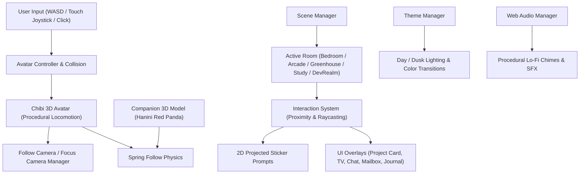

# Technical Architecture & Systems Overview

"Little Game Room" is engineered with modular vanilla Three.js and modern TypeScript, avoiding heavy component frameworks to achieve instant loading and smooth 60 FPS performance on web and mobile devices.

---

## Architecture Diagram

---

## Core Systems Breakdown

1. **Renderer & Loop (`src/core/renderer.ts`, `src/core/loop.ts`):**
   - Single `WebGLRenderer` configured with `SRGBColorSpace` and `NoToneMapping` for faithful pastel color reproduction.
   - Fixed render loop clamping delta time to 0.05 to prevent animation jumps on tab switching.
   - Automatically pauses rendering when fullscreen overlays are expanded or when the browser tab is hidden.

2. **Quality Manager (`src/core/quality.ts`):**
   - Three tiers (`high`, `medium`, `low`).
   - Clamps `devicePixelRatio` (High: 2, Medium: 1.5, Low: 1).
   - Adjusts particle counts (150 down to 20 sparkles).

3. **Locomotion & Collision (`src/world/avatar/controller.ts`, `src/world/collision.ts`):**
   - Camera-relative directional movement with acceleration and damping.
   - Circle vs AABB 2D sliding collision in the XZ plane.
   - Procedural chibi animation state machine (Idle breathing, Walk bobbing, Run lean, Happy Hop jump, and Look-Around).

4. **Scene Streaming (`src/world/sceneManager.ts`):**
   - One active room in memory at a time; previous room meshes, geometries, and textures are explicitly disposed during doorway transitions.
   - Smooth 360ms pastel fade transition.

5. **Theme Manager (`src/world/theme.ts`):**
   - Smoothly interpolates `themeProgress` (0 = Day, 1 = Dusk).
   - Controls ambient light, directional sun/moon intensity, fog, background color, and lamp light.
