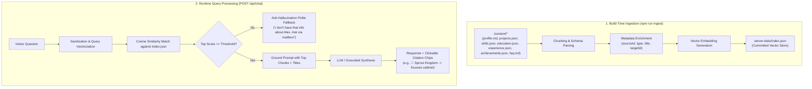

# RAG Pipeline Architecture & Explanation

This document details the Retrieval-Augmented Generation (RAG) system powering **Zuzu**, the friendly companion AI in Alex Morgan's interactive 3D portfolio.

---

## 1. Pipeline Overview

---

## 2. Chunking Strategy

All source documents originate in `/content`. The ingestion script (`scripts/ingest.ts`) processes documents into structured chunks:

1. **Granularity:** One logical chunk per atomic record.
   - Each project in `projects.json` produces a chunk containing title, year, tagline, roles, contributions, description, and technologies.
   - Each skill category in `skills.json` produces a chunk with proficiency level and technical blurb.
   - Each role in `experience.json` and degree in `education.json` produces a self-contained chunk.
   - `profile.md` and `faq.md` are sectioned into focused thematic chunks.
2. **Metadata Attachment:** Every chunk is tagged with:
   - `id`: Unique identifier (e.g., `proj-game-01`).
   - `title`: User-friendly display title.
   - `type`: Category (`project`, `skill`, `education`, `experience`, `achievement`, `profile`, `faq`).
   - `targetId`: Corresponding 3D object anchor (e.g., `DOOR_game`, `DOOR_greenhouse`, `DOOR_study`, `mailbox`).

---

## 3. Retrieval Parameters & Anti-Hallucination

- **Vector Distance:** Cosine similarity between the normalized query vector and chunk vectors.
- **Top-K:** Filtered to top 3-5 matches.
- **Strict Threshold (`RAG_MIN_SCORE = 0.35`):** If the cosine similarity of the top chunk falls below the confidence cutoff, the system triggers the polite fallback instead of guessing:
  > *"Mew! I don't have that info about Alex in my notes. You can write directly to Alex using the mailbox in the bedroom!"*
- **Source Citation Chips:** Responses render clickable chips (`📌 Sprout Kingdom`, `🌿 Unity & C#`) that allow visitors to automatically travel to and inspect the exact 3D cabinet or garden plant in the portfolio world.
